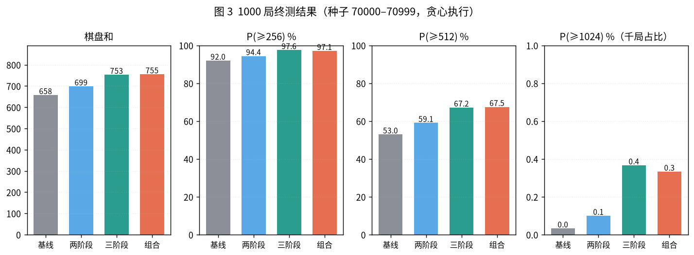
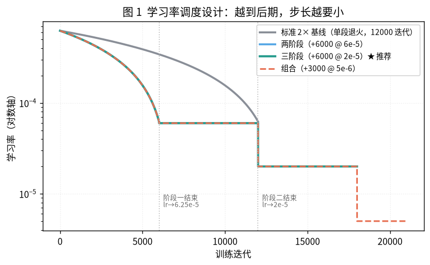
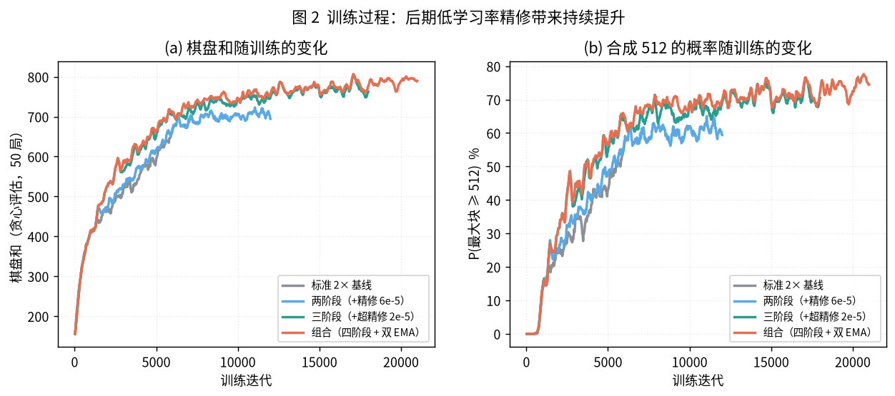
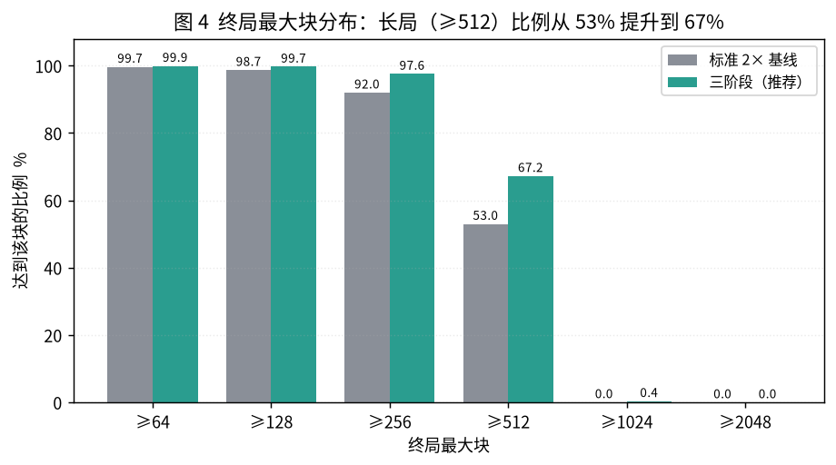
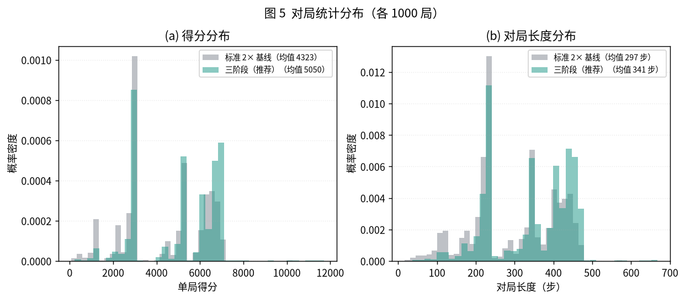
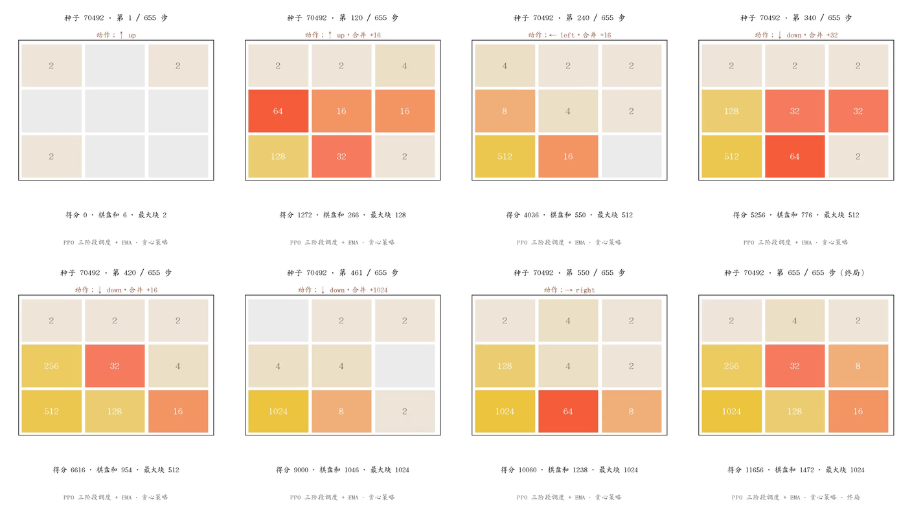

# 3×3 2048 的 PPO 训练：实验设立与优化设计

本文介绍当前的**最优训练方案**、它的设计动机，以及实测结果。
一句话结论：**通过「多阶段学习率调度 + 权重 EMA」，把棋盘和从 657.7 提升到 753.5，
P(合成 512) 从 53.0% 提升到 67.2%，达到 3×3 2048 理论最优的 92.3%。**

| 指标 | 标准 PPO 基线 | **本方案（三阶段）** | 变化 |
|---|---:|---:|---:|
| 棋盘和 | 657.7 ± 11.4 | **753.5 ± 12.2** | **+95.8** |
| P(最大块 ≥ 256) | 92.0% | **97.6%** | +5.6pp |
| P(最大块 ≥ 512) | 53.0% | **67.2%** | +14.2pp |
| P(最大块 ≥ 1024) | 0.03% | **0.37%** | **约 12 倍** |
| 期望得分 | 4,323 | **5,050** | +727 |
| 占理论最优（≈5,470）| 79.0% | **92.3%** | +13.3pp |

---

## 1. 实验设立

### 1.1 游戏规则（3×3 变体）

棋盘 3×3、共 9 格。每步玩家选择一个方向（左/右/上/下），所有方块沿该方向滑动并合并
相同数字的相邻块（一次移动中每块最多合并一次，合并得分 = 合并后的数值）。
移动有效后，在随机空格生成一个新块：**2 的概率 0.9，4 的概率 0.1**。
无合法移动时对局结束。**得分即为所有合并数值之和**。

### 1.2 MDP 形式化

| 要素 | 定义 |
|---|---|
| 状态 s | 3×3 棋盘（9 格，每格为 2^k 或空） |
| 动作 a | 4 个方向，非法方向被掩码排除 |
| 奖励 r | 合并得分 × **0.25**（奖励缩放）|
| 转移 | 移动（确定性）+ 生成新块（随机，空格均匀 / 2:4 = 0.9:0.1）|
| 终止 | 无合法动作 |

### 1.3 状态编码与网络

- **状态编码**：每格 16 个通道（2^0 到 2^15）的 one-hot，共 **9×16 = 144 维**
- **网络**：策略网络与价值网络**各自独立的 MLP**（避免梯度干扰），
  结构均为 144 → 256 → 256 → 输出，策略输出 4 个 logits（非法动作置 -1e8），价值输出标量
- 参数量约 20 万；**实测加大到 512 宽并无收益**（见 §4.4）

### 1.4 训练超参数

| 参数 | 值 | 参数 | 值 |
|---|---|---|---|
| 并行环境数 | 64 | 每迭代步数 | 64 × 128 = 8192 |
| 折扣因子 γ | 0.995 | GAE λ | 0.95 |
| PPO clip ε | 0.2 | 每批更新 epochs | 10 |
| minibatch | 2048 | 优势标准化 | 是 |
| 价值损失系数 | 0.5 | 梯度裁剪 | 0.5 |
| 熵系数 | 0.02 → 0.002（线性退火）| 初始学习率 | 6.25e-4 |
| 优化器 | Adam | 训练种子 | 2 / 3 / 4 |

**工程加速**：推理与更新均用 **CUDA Graph** 捕获，每步只有 1 次 H2D（约 36 KB）
和 1 次 D2H（约 1.25 KB），单进程约 37k steps/s。

### 1.5 评测协议

统一用 **1000 局独立测试**：固定随机种子 70000–70999，贪心（argmax）执行，
统计棋盘和、最大块分布与期望得分。因为每局种子固定，不同配置之间可以做**逐局配对比较**，
大幅降低评估噪声。训练过程中的验证用 50 局（噪声较大，仅作监控）。

---

## 2. 优化设计

### 2.1 核心洞察：真正的瓶颈是「后期学习率过大」

标准配方在 2× 预算（约 2450 万步）处出现平台：继续加训练步数反而**变差**
（4× 预算时均值从 657.7 掉到 619.1，三个种子里有两个崩溃）。起初我们以为是
「奖励稀疏」或「容量不足」，但一系列实验排除了这两者，最终定位到**优化漂移**。

**证据是策略位移的累积量。** 用 KL（新旧策略分布差异）衡量「每次更新把策略改了多少」，
统计整个训练的累积 ΣKL：

| 调度 | 后半程累积 KL | 结果 |
|---|---:|---|
| 单段退火拉长到 4× | 12.7 – 16.0 | 部分种子漂移崩溃 |
| 快速退火 + 恒定低 lr | **4.0 – 4.2** | 三个种子全部稳定 |

**机制**：Adam 按梯度幅度归一化，因此**每步参数位移 ≈ 学习率**，与梯度大小无关。
训练后期真实梯度趋近于零，而 Adam 仍然迈出与 lr 同量级的一步——此时方向主要由
噪声和 critic 偏差决定。累积几千次之后，策略被推出好的区域；又因为数据由策略自身生成，
漂移是**不可逆**的（策略变差 → 采到坏数据 → critic 学到坏价值 → 优势估计更差）。

> **一句话**：不是「学不动了」，而是「走得太远、回不来了」。解决办法不是加步数，而是**减小后期的步长**。

### 2.2 设计一：多阶段学习率调度（核心贡献）

把「单一线性退火」改成**三段式**：先快速退火到低位，再在固定的低学习率上长时间精修。

| 阶段 | 迭代区间 | 学习率 | 熵系数 |
|---|---|---|---:|
| 一：主学习 | 1 – 6000 | 6.25e-4 → 6.25e-5（线性退火）| 0.02 → 0.002 |
| 二：精修 | 6001 – 12000 | **6e-5（恒定）** | 0.002 |
| 三：超精修 | 12001 – 18000 | **2e-5（恒定）** | 0.002 |

总 18000 迭代 × 8192 步 = **约 1.475 亿步**（与 4× 预算相同，但调度形状不同）。

**为什么恒定低 lr 比「慢慢退火」更好**：缓慢退火意味着中后期长期停留在中间偏高的
学习率（例如 4× 调度在第 6000 迭代时 lr 还有 3.44e-4，是三段式同期的 5.5 倍）。
那额外的 4900 万步全部是「大步子」走出来的，累积位移远超安全范围。
**三段式用同样的步数，但把中后期的步长压到安全区。**

### 2.3 设计二：权重 EMA（免费增益）

训练时旁路维护一份权重的指数滑动平均（β = 0.999），等效于对最近约 1000 次迭代的权重做加权平均。
**它不改变训练本身**，只是多维护一份副本：每次验证时同时评估原始权重与 EMA 权重，
取更优者保存为 best.pt。

**原理**：平台期权重在最优解附近随机游走，原始权重是这条轨迹的**单个快照**（含噪声），
EMA 是其**平均位置**（落在噪声云中心），通常更接近真实最优。

**实测收益 +13 ~ +30 分**，且**训练越不稳定收益越大**——这正好印证了上述机制。

### 2.4 设计三：CUDA Graph 加速（工程）

144→256→256 的小网络在 GPU 上的耗时几乎全是 kernel 启动与派发开销。我们把
**推理**（每步一次图重放，替代原来的多次小 kernel）与 **PPO 更新**（gather→损失→反向）
都捕获为 CUDA Graph，统计量在图内累加、每迭代只同步一次。
实测把推理从 0.62 ms/步降到 0.168 ms/步，更新从 132 ms 降到 17.4 ms/迭代，
整体约 **3.7–7.6 倍**加速，使 1.475 亿步的训练在单卡 3090 上约 45–66 分钟完成。

---

## 3. 实验结果

### 3.1 训练过程

前 6000 迭代四条曲线几乎重合（主学习期），差异全部出现在中后期。
单段退火（灰）在约 650 停止增长；两阶段（蓝）继续爬到约 700；
**三阶段（绿）在 12000 迭代进入超精修后继续爬升到 750 以上**，且全程没有回落。

### 3.2 终测结果

| 配置 | 棋盘和 | 种子 std | P(≥256) | P(≥512) | P(≥1024) | 期望得分 |
|---|---:|---:|---:|---:|---:|---:|
| 标准 2× 基线 | 657.7 | 11.4 | 92.0% | 53.0% | 0.03% | 4,323 |
| 两阶段（+6000 @ 6e-5）| 698.7 | 12.5 | 94.4% | 59.1% | 0.10% | 4,630 |
| **三阶段（+6000 @ 2e-5）** | **753.5** | 12.2 | **97.6%** | **67.2%** | **0.37%** | **5,050** |
| 组合（四阶段 + 双 EMA）| 755.3 | 12.4 | 97.1% | 67.5% | 0.33% | 5,062 |

**配对检验**（同种子逐局 bootstrap，95% 置信区间）：三阶段 vs 两阶段，
三个种子分别 **+58.3* / +48.7* / +57.4***（全部显著为正）。

### 3.3 长局能力：从 512 到 1024

合成 512 的概率从 53.0% 提升到 67.2%，**合成 1024 的概率从 0.03% 提升到 0.37%（约 12 倍）**。
长局的出现意味着策略不仅在「保底」上更强，在**极限延寿**上也有实质进步。

期望得分分布整体右移，平均对局长度从 297 步增加到 341 步。

### 3.4 一局达到 1024 的完整对局

下面是一局实际对局（种子 70492，贪心执行）的关键节点：

- **第 461 步**：向下移动时合并出 **1024**（此时得分 9,000、棋盘和 1,046）
- **第 655 步终局**：得分 **11,656**、棋盘和 **1,472**、棋盘上同时保留
  1024 / 256 / 128 / 32 / 16 / 8 / 4 / 2 / 2 共 9 格
- 关键在于中盘**持续维持足够的空格**

完整录像（655 步，10 fps，65 秒）：**[▶ 观看 seed_70492.mp4](videos/seed_70492.mp4)**

### 3.5 与理论最优的距离

3×3 2048 已被**强解**（枚举全部 48,713,519 个合法状态并逆推精确价值），
最优策略的期望得分约为 **5,470 分**。以此为标尺：

| 配置 | 期望得分 | 占最优比例 |
|---|---:|---:|
| 标准 PPO 基线 | 4,323 | 79.0% |
| 两阶段 | 4,630 | 84.6% |
| **本方案（三阶段）** | **5,050** | **92.3%** |

**剩余缺口约 7.5%（408 分）**，且集中在尾部（P(≥1024) 仍然只有千分之几）。

---

## 4. 设计边界（哪些改动没有用）

以下结论均来自实测（1000 局、同种子配对），列出来是为了避免重复走弯路：

### 4.1 继续增加训练步数 / 更低学习率

在四阶段调度中再加一段 5e-6（3000 迭代），只带来 **+1.9 分（不显著）**，
且三个种子里有两个的 best 检查点根本没有变化——**已经饱和**。

### 4.2 放宽折扣因子 γ

γ = 0.998（有效视野从 200 步扩到 500 步）实测 +3.9 分，不显著。
而且诊断显示：卡在 256 的对局平均死于第 **215 步**，把视野放宽后这个数字**纹丝不动**
（214–215 步）——死亡不是「看不见远处」，而是局面的真实物理死期。

### 4.3 奖励塑形

- 首次合成 512 时额外给 +200 奖励：**−3.7 分**（两个种子显著更差）
- 基于棋盘结构的稠密势函数塑形：**−1.3 分**（不显著）

奖励稀疏不是瓶颈——**把稀疏奖励变大，信噪比并不会改善**。

### 4.4 加大网络容量

| 宽度 | 参数量 | 棋盘和（三阶段调度） |
|---|---:|---:|
| 256 | ~20 万 | **753.5** |
| 512 | ~67 万 | 750.1 |
| 1024 | ~240 万 | （旧调度下仅 561，明显更差）|

**容量不是瓶颈**：512 与 256 在统计上没有差异，1024 反而更难训。

### 4.5 其他方法论尝试

分支采样（GRPO 风格的组内对比优势）、afterstate 价值 + 模型期望优势、
两阶段复热等方案均实测**显著劣于**上述配置。核心原因是这些方案都试图
「从 on-policy 数据里提取更多对比信号」，而实测单步动作差异（28）远小于
随机新块带来的运气噪声（47），**信噪比 0.60**——增加对比样本需要指数级算力。

---

## 5. 复现

~~~bash
# 推荐配置（三阶段 + EMA），单卡 3090 约 45–66 分钟
python train.py \
  --run-name my_best \
  --iters 6000 --extend-iters 6000 --extend-lr 6e-5 \
  --extend2-iters 6000 --extend2-lr 2e-5 \
  --ema-decay 0.999 \
  --epochs 10 --lr 6.25e-4 --seed 2
~~~

关键参数说明：

| 参数 | 含义 |
|---|---|
| --iters / --lr | 第一阶段迭代数与初始学习率（线性退火到 --lr-final-ratio 倍）|
| --extend-iters / --extend-lr | 第二阶段：恒定学习率精修 |
| --extend2-iters / --extend2-lr | 第三阶段：超精修（**最大收益来源**）|
| --extend3-iters / --extend3-lr | 第四阶段（可选，实测已饱和）|
| --ema-decay / --ema-decays | 单 EMA / 多 EMA（后者可同时维护多个衰减系数）|

训练完成后：best.pt（验证指标最优，可能是原始或 EMA 权重）、last.pt（结束时原始权重）、
eval_log.csv（训练期曲线，含 raw_board_sum / raw_p512 原始权重列）。

评测（1000 局，固定种子）：

~~~bash
python evaluate.py --ckpt results/my_best/best.pt --episodes 1000 --seed 70000 --env fast
~~~

---

## 6. 局限与展望

1. **尾部仍是弱项**：P(≥1024) 只有 0.37%。要显著提升长局比例，可能需要
   **决策时搜索**（推理阶段做 expectimax，用已知的新块分布做期望备份），
   但这会把方法从「纯策略」变成「策略 + 搜索」。
2. **剩余 7.5% 的理论缺口**主要来自长局尾部，靠调整训练配方已很难推进。
3. **适用面**：多阶段学习率调度针对的是「长视野 + 高随机性 + 后期梯度趋零」
   这类问题，原理上适用于其他类似的随机决策任务。

---

## 附：文件索引

| 路径 | 内容 |
|---|---|
| figures/best/fig1–fig6*.png | 本文全部图表（由 make_best_figs.py 生成）|
| videos/seed_70492.mp4 | 达到 1024 的完整对局录像 |
| results/final_v2/ | 全部配置的 1000 局终测数据（summary + 逐局 CSV + 训练曲线）|
| results/final_v2/report.md | 实验数据汇总报告 |
| results/final_v2/INDEX.md | 检查点与数据索引 |
| gpu_graph.py | CUDA Graph 实现（推理图 + 更新图）|
| train.py | 训练脚本（含多阶段调度、EMA 等全部功能）|
| PPO_IMPLEMENTATION.md | PPO 实现细节文档 |
