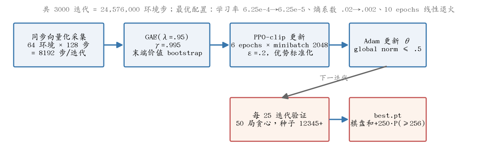
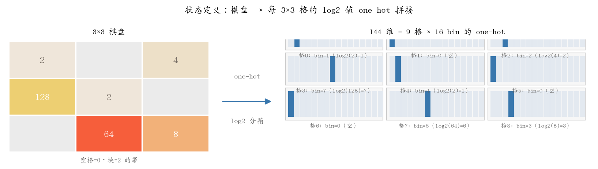
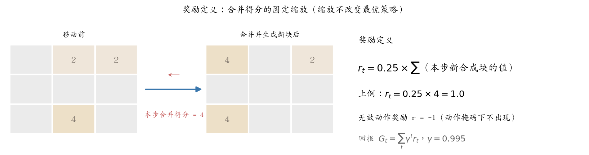
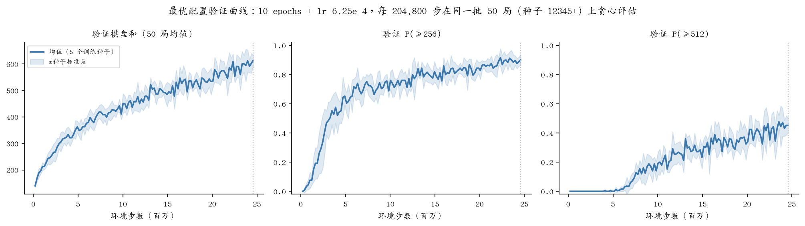
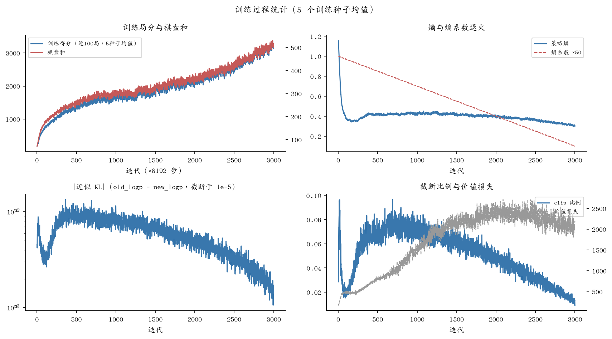
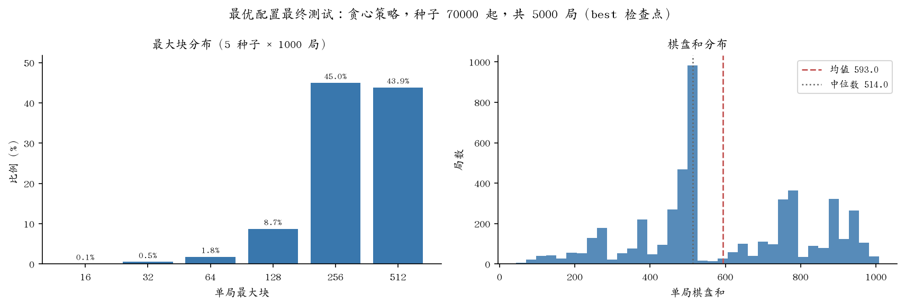

# PPO 实现：3×3 2048 的完整技术路径

本文整理 PPO 在 3×3 2048 上的完整实现与实验，包括默认配置基线（`results/main/`）
与最终采用的最优配置（`results/sensitivity/epochs10_lr625e4_s*`，第 11 节）。
全部细节与 `game2048_env.py`、`ppo.py`、`train.py` 的实际代码一一对应。第 11 节的
超参数敏感性实验由 `run_sensitivity_experiments.py` 训练、`compare_sensitivity.py`
评测出图；其余图表由 `make_ppo_report_figs.py` 从现有实验数据生成，均可重复运行。

**一句话结果**：最终采用的最优配置（10 epochs + lr 6.25e-4，其余同默认配置）以
24,576,000 环境步预算、**5 个训练种子**训练，在 5000 局独立测试（训练完全未接触过
的种子）上平均棋盘和 **593.0 ± 18.9**，**88.9%** 的对局达到 256（Wilson 95% 区间
[88.0%, 89.7%]），**43.9%** 达到 512（[42.5%, 45.2%]）。训练充分性检验（11.1 节）
显示预算扩展至 49,152,000 步（3 种子）可进一步提升至 **657.7 ± 14.0**、92.0%、
53.0%。作为对照，默认配置（6 epochs + lr 2.5e-4，单训练种子）为 496.9 / 82.5% /
26.2%，差异来源见第 11 节。



## 1. PPO 原理与思想

### 1.1 问题设定：马尔可夫决策过程

强化学习把序贯决策建模为马尔可夫决策过程（MDP）：智能体在每步观察状态 s_t，按
策略 π(a|s) 选择动作 a_t，环境返回奖励 r_t 和新状态 s_{t+1}，直到终止。学习目标
是调整 π 使折扣回报 G_t = Σ_k γ^k r_{t+k} 的期望最大。在本文任务中的对应：s_t 是
144 维棋盘编码（第 3 节），a_t 是四个滑动方向之一（第 4 节），r_t 是合并得分
×0.25（第 5 节），一局游戏就是一条轨迹，无合法动作时终止。

### 1.2 在方法谱系中的位置：策略梯度 + Actor-Critic

解决 MDP 有两大思路。**价值方法**（如 DQN）先学每个状态-动作的价值 Q(s,a)，策略
由"选 Q 最大的动作"间接得到；**策略方法**直接参数化策略本身 π_θ(a|s)，由策略梯度
定理对 θ 做梯度上升：

∇J(θ) = E[ ∇_θ log π_θ(a|s) · A^π(s,a) ]

直觉：如果某动作比当前策略的平均水平"好"（优势 A>0），就提高它的概率，反之降低。
纯策略梯度的困难在于优势需要估计——这正是 critic 的职责。**Actor-Critic** 用两个
网络分工：actor（策略网络）输出动作分布并产生梯度，critic（价值网络）估计 V(s)
并据此构造优势信号。PPO 属于这一类：本项目的两塔独立网络（第 6 节）分别承担
这两个角色。

### 1.3 PPO 是"近似策略迭代"

经典策略迭代（广义策略迭代框架）在两步之间交替直到收敛：

- **策略评估**：计算当前策略的价值（经典做法是迭代求解贝尔曼方程）；
- **策略改进**：让新策略对当前价值贪心（选优势最大的动作）。

PPO 保留这一骨架，把两步都换成基于采样的近似版本；"采集 → 评估 → 改进"循环
3000 次，就是 3000 轮近似策略迭代：

| 经典策略迭代 | PPO 中的对应 | 近似方式 |
|---|---|---|
| 策略评估 | critic 回归 + GAE 优势估计 | 不精确解贝尔曼方程，用采样 + bootstrap（第 7 节） |
| 策略改进 | 截断策略梯度上升 | 不做完全贪心，沿优势方向只走一小步 |

与经典版本的关键差异在**改进步的幅度**：完全贪心的新策略可能与旧策略相差任意
远，在采样近似下这种大跳步会被估计误差放大导致崩塌。PPO 用 clip 目标把新旧策略
的偏离限制在 ε=0.2 的比率区间内——每轮只走信任域内的一小步，换来 3000 轮的稳定
上升（训练曲线见第 9 节）。

### 1.4 一次迭代的四个步骤

对应 `train.py` 的主循环，每轮迭代（8192 环境步）依次做四件事（流程图见文档开
头 fig1）：

1. **采集（rollout）**：64 个环境并行推进 128 步；每步用当前策略采样动作，记录
   (s, a, log π_old(a|s), V(s), r, done)。数据必须由"当前"策略产生，这是 on-policy
   方法的定义约束。
2. **评估（GAE）**：用 critic 的 V(s) 与实际奖励计算单步 TD 残差，按 GAE(λ=0.95)
   指数加权合成优势 Â_t——"动作 a_t 比当前策略在该状态的平均期望好多少"。
3. **改进（PPO-clip 更新）**：对同一批数据做 6 个 epoch 的截断梯度上升。重要性采
   样比率 ρ = π_new/π_old 度量策略已偏移多少，ρ 超出 [1−ε, 1+ε] 的样本不再产生推
   力——因此同一批数据可以反复使用（区别于严格单次使用的 A2C），而策略不会被单
   批数据带偏。
4. **循环**：丢弃数据，用改进后的策略回到第 1 步；学习率与熵系数随迭代线性退火，
   训练从探索逐步转向收敛。

GAE 递推、clip 损失与价值裁剪的精确公式和全部超参数见第 7 节。

## 2. 任务定义

- **游戏**：3×3 棋盘的 2048。初始随机放 2 个块（90% 为 2、10% 为 4）；每步四方向
  滑动，相同块相撞合并（每对每步只合并一次）；滑动无效则不生成新块；无合法动作时终止。
- **目标**：提高终局棋盘和，并尽量达到 256 块。检查点选择指标据此设为
  `棋盘和 + 250 × P(≥256)`。
- **环境实现**：自写 Gymnasium 环境 `Game2048Env3x3`（`game2048_env.py`），纯
  Python、无渲染依赖，滑动合并逻辑有独立单元测试。

## 3. 状态定义

状态为 **144 维 one-hot 向量**，由三步构成：

**第一步：格子取值离散化（log2 分箱）。** 棋盘 3×3 共 **9 个格子**，每格的取值只
可能是"空"或某个 2 的幂。对块值取以 2 为底的对数，得到 0–15 的整数索引（bin
序号）：

| 格子内容 | 空 | 2 | 4 | 8 | 16 | … | 128 | 256 | … | ≥32768 |
|---|---|---|---|---|---|---|---|---|---|---|
| bin 序号 | 0 | 1 | 2 | 3 | 4 | … | 7 | 8 | … | 15（截断） |

即 bin 0 表示空格，bin k 表示块值 2^k。取 log2 的意义在于：2048 的一切规则关系都
发生在指数层面——合并是"相邻同 bin 的格子 bin+1"，大小比较是 bin 比较——取对数
后这些关系在线性空间中均匀分布。bin 数取 **16** 的原因：bin 0 覆盖空格，bin 1–15
覆盖 2 到 2^15=32768。3×3 棋盘实际能合成的最大块是 1024（bin 10），16 个 bin 留有
余量；超出部分截断到 bin 15（代码 `min(x.bit_length()-1, 15)`），实测从未触发。

**第二步：每个格子用 16 维 one-hot 表示。** 每格的 bin 序号不直接作为数值输入，
而是展开成一个 **16 维 one-hot 向量**：只有 bin 序号对应的位置为 1，其余 15 位为
0。例如某格内容是 8（bin 3），它的 16 维表示为

```
[0, 0, 0, 1, 0, 0, 0, 0, 0, 0, 0, 0, 0, 0, 0, 0]
```

空格（bin 0）则是第 0 位为 1：`[1, 0, …, 0]`。因此**每一个格子恒定对应 16 个维度，
无论它是空、小块还是大块**——编码长度不随局面变化。

**第三步：9 格拼接成 144 维。** 9 个格子按行优先顺序各贡献 16 维，拼接成
9 × 16 = **144 维**状态向量。第 i 格占据第 `i×16` 至 `i×16+15` 维；反过来，向量第
d 维为 1 当且仅当"格 `d//16` 的内容为 2^(d mod 16)"（d mod 16 = 0 且该格为空时同
样为 1）。对应实现是 `game2048_env.py` 的 `_encode()`：

```python
k = min(x.bit_length() - 1, 15) if x else 0   # 块值 → bin 序号
feats[(r * self.size + c) * NUM_CHANNELS + k] = 1.0   # NUM_CHANNELS = 16
```



## 4. 动作空间与动作掩码

- 动作空间 `Discrete(4)`：0=左、1=右、2=上、3=下。
- **动作掩码**：`action_mask()` 返回每个方向能否改变棋盘；策略网络输出的非法动作
  logits 被置为 −1e8，保证采样与 argmax 只在合法动作上进行。因此无效动作的 −1
  惩罚在训练中实际不会触发。
- 评估时使用贪心策略（logits argmax），训练时从掩码后的分类分布采样。

## 5. 奖励定义

$$r_t = 0.25 \times \sum (\text{本步新合成块的值})$$

- 奖励即该步的合并得分（如两个 2 合成 4 得 4 分），乘固定系数 0.25 控制数值尺度。
- 正的常数缩放不改变折扣回报的最优策略，只影响网络训练的数值稳定性。
- 折扣回报 $G_t = \sum_k \gamma^k r_{t+k}$，γ = 0.995（约相当于 200 步视野，
  与单局长度匹配）。



## 6. 网络结构

策略与价值使用**各自独立的 MLP**（不共享底层，避免两类梯度的相互干扰）：

| 网络 | 结构 | 输出 | 初始化 |
|---|---|---|---|
| 策略 π | 144 → 256 (ReLU) → 256 (ReLU) → 4 | 动作 logits | 正交初始化：隐层 gain=√2，输出层 gain=0.01 |
| 价值 V | 144 → 256 (ReLU) → 256 (ReLU) → 1 | 状态价值标量 | 正交初始化：隐层 gain=√2，输出层 gain=1.0 |

偏置全零初始化。参数量：策略 103,940 + 价值 103,169 = **207,109**。

## 7. 训练算法

第 1.4 节给出了概念流程；本节给出精确公式与全部超参数。

**采集**：64 个环境同步推进，每次迭代采集 128 步（64×128 = 8192 步），存入
`[T=128, N=64]` 的 rollout 缓冲区（obs、mask、action、log_prob、value、reward、done）。
环境终止后立即 reset，终止观测完整保留在缓冲区中。

**bootstrap（自举）**：估计某状态的价值时，不等真实未来展开，而是用价值网络对下
一状态的估计 V(s_{t+1}) 代替"未来还会得到多少"。对照两种记账方式：蒙特卡洛（MC）
等一局结束，用真实后续回报 G_t——无偏，但方差大（同样的局面因随机块不同，终局
可以相差数百）；bootstrap 用 r + γV(s_{t+1})——V 不准则有偏，但方差小得多。本实
现中采集每 128 步截断一次（不等一局打完），截断处的 `last_values = model.value(obs)`
就是 bootstrap：没有它，片段之后的真实回报永久丢失，价值学习与优势估计都会在截
断处断裂。

**优势估计（GAE）**：优势要回答"动作 a_t 比当前策略的平均水平好多少"，困难在于
记账长度——看未来 1 步（TD）还是看到局尾（MC）？GAE 把所有长度的估计按指数权
重折中：先算每步 TD 残差（每项都含一次 bootstrap），再以 (γλ)^l 加权求和：

$$\delta_t = r_t + \gamma V(s_{t+1})\,(1-done_t) - V(s_t),\qquad
\hat A_t = \sum_{l\ge 0} (\gamma\lambda)^l\, \delta_{t+l}
= \delta_t + \gamma\lambda\,(1-done_t)\,\hat A_{t+1}$$

两个极端：λ=0 时 Â=δ_t，纯单步——V 的估计误差直接进入优势（偏差大），但方差
最小；λ=1 时各 V 项在求和中相消，GAE 退化为蒙特卡洛——无偏，但方差大。λ=0.95
配合 γ=0.995 的等效衰减率为 γλ≈0.945，记账有效视野约 1/(1−γλ) ≈ 18 步：主要依
赖 V 的 bootstrap，同时保留真实奖励的纠偏。实现按上式右端从后往前递推（`ppo.py`
的 `compute_gae`，(1-done) 保证终止状态不向外传递价值），输出 8192 个逐样本优
势，作为策略梯度的信号。

**PPO-clip 更新**：对同一份 rollout 做 10 个 epoch、按 2048 大小的 minibatch 随机
切分更新。每个 minibatch 内优势标准化。策略损失、价值损失与总损失：

$$L^{pi} = -\mathbb{E}\big[\min(\rho_t \hat A_t,\ \mathrm{clip}(\rho_t, 1\pm\varepsilon)\hat A_t)\big],\quad
\rho_t = \frac{\pi_\theta(a_t|s_t)}{\pi_{\theta_{old}}(a_t|s_t)},\ \varepsilon=0.2$$

$$L^V = 0.5\,\mathbb{E}\big[\max\big((V_\theta - R_t)^2,\ (V^{clip}_\theta - R_t)^2\big)\big],\quad
V^{clip}_\theta = V_{old} + \mathrm{clip}(V_\theta - V_{old}, \pm\varepsilon)$$

$$L = L^{pi} + 0.5\,L^V - c_{ent}\,H[\pi_\theta](\cdot)$$

优化器 Adam，全局梯度范数裁剪 0.5。每步记录 pi_loss、v_loss、熵、近似 KL、
截断比例，用于监控训练健康度。

**梯度是 8192 个样本的平均，而不是单条轨迹**。策略梯度定理 ∇J(θ) = E[∇log π·Â]
是对轨迹分布的期望，需要用样本平均逼近；本实现每一轮用 64 个并行环境的 128 步
片段（共 8192 个 (s,a) 样本）做经验平均——这正是"求和估计平均"，只是求和单位
是轨迹上的每个时间步，而非整条轨迹。两点澄清：

- **片段而非完整轨迹**：每条轨迹只取 128 步即截断，靠 V(s_T) bootstrap 兜底（见
  上），信用传播由 GAE 的 γλ 衰减截断（有效视野约 18 步），不需要等一局打完。
- **样本相关**：8192 个样本来自 64 条轨迹，局内高度相关，等效样本量小于 8192。
  补偿有三层：64 个环境种子不同（横向去相关）、每个样本减去自己的基线 V(s)（扣
  除整局公共波动）、λ<1 缩短记账链。

此外，这批数据不是估出一次梯度就走一步：PPO 对同一批 8192 个样本做 6 epoch ×
4 个 minibatch = 24 次小步更新，每个 minibatch 的梯度是批平均的更噪子样本。敢于
这样复用数据依赖三重保护：记录采集时的 log π_old，用比率 ρ 修正"数据过时"的程
度；clip 把 ρ 限制在 [0.8, 1.2]，一批数据最多把策略挪多远存在硬上限；近似 KL 与
截断比例实时监控偏移量（fig6，全程约 2%–5%）。作为对照，最原始的 REINFORCE 用
单条轨迹估一次梯度就更新——期望上无偏、方差上灾难；PPO 的向量化采集、基线、
GAE 与信任域，每一层都是在给这个方差问题打补丁。

**超参数总表**（与 `best.pt` 内保存的实跑配置一致）：

| 类别 | 参数 | 值 |
|---|---|---|
| 采集 | 并行环境 × 每环境步数 | 64 × 128 = 8192 步/迭代 |
| 采集 | 总迭代 / 总步数 | 3000 / 24,576,000 |
| 优化 | 学习率（Adam） | 6.25e-4 → 6.25e-5 线性退火（终值比 0.1） |
| 优化 | 折扣 γ / GAE λ | 0.995 / 0.95 |
| 优化 | PPO 截断 ε / epochs / minibatch | 0.2 / 10 / 2048 |
| 优化 | 价值系数 vf_coef / 梯度裁剪 | 0.5 / 全局范数 0.5 |
| 探索 | 熵系数 | 0.02 → 0.002 线性退火 |
| 奖励 | reward_scale | 0.25（奖励 = 合并得分 × 0.25） |
| 网络 | 隐藏层宽度 | 256（两塔各两层） |
| 评估 | 验证频率 / 局数 | 每 25 迭代（204,800 步）/ 50 局贪心，种子 12345–12394 |
| 训练 | 随机种子 / 设备 | 2–6（五种子平均）/ RTX 3090 |

以上为本文采用的最优配置；默认配置（6 epochs、学习率 2.5e-4，其余相同）在第 11 节
敏感性实验中作为基线对照，两者差异的来源与量级见该节。

## 8. 模型选择规则

每 25 迭代在**固定 50 局验证集**（种子 12345 起，训练中从未学习）上贪心评估，
按 `棋盘和均值 + 250 × P(≥256)` 保存 `best.pt`；`last.pt` 每 200 迭代保存。该规则
只使用验证集，所有最终测试成绩均来自训练后用新种子做的独立评估。最优配置的
五个种子的 best 检查点分别位于 **23.1、22.3、24.4、23.3、21.9M** 步——全部贴近
2458 万步预算的末端，这一现象是第 11.1 节预算充分性检验的直接动机。

## 9. 训练过程数据（最优配置，5 个训练种子）



关键里程碑（同一验证集，5 个种子的均值 ± 种子标准差）：

| 训练步数 | 验证棋盘和 | P(≥256) | P(≥512) |
|---:|---:|---:|---:|
| 2,048,000 | 254.1 ± 28.6 | 26% | 0% |
| 4,710,400 | 351.5 ± 35.2 | 64% | 0% |
| 8,601,600 | 417.2 ± 32.2 | 71% | 12% |
| 12,288,000 | 456.0 ± 31.4 | 72% | 27% |
| 16,384,000 | 546.9 ± 42.3 | 81% | 39% |
| 20,480,000 | 568.4 ± 39.7 | 87% | 42% |
| 24,576,000（最终） | **613.3 ± 21.9** | 90% | 45% |

与默认配置（第 11 节基线，最终验证 528.4）相比，最优配置在中期即建立优势，且
**曲线到预算末端仍未走平**——最后一次验证（613.3）是全程最高点，五个种子的
best 检查点全部落在预算末端 25% 内。这说明 2458 万步尚未饱和，直接引出 11.1 节
的预算充分性检验。



训练全程健康：熵随退火平稳下降、无崩塌（末期约 0.30–0.32）；近似 KL 保持在
2e-3 以下、截断比例约 0.4%–1.1%，说明 ε=0.2 + 10 epochs 的更新幅度没有破坏
信任域。

## 10. 最终独立测试

测试协议：**5 个训练种子 × 1000 局，种子 70000–70999**（这批种子未参与任何训练、
验证或检查点选择），贪心策略，各取 best 检查点，共 5000 局。

| 指标 | 值 |
|---|---:|
| 平均得分 | 3838.4 ± 1791.6 |
| 平均棋盘和 | **593.0 ± 225.1** |
| 平均局长 | 267.5 步 |
| P(≥128) | 97.6% |
| P(≥256) | **88.9%**（Wilson 95% 置信区间 [88.0%, 89.7%]） |
| P(≥512) | **43.9%**（Wilson 95% 置信区间 [42.5%, 45.2%]） |

前两行为 5000 局（5 种子）合并统计，± 为局间标准差；种子间的棋盘和差异更小
（593.0 ± 18.9，见第 11 节）。作为对照，默认配置（单训练种子、1000 局）为
496.9 ± 197.5 / 82.5% / 26.2%。



## 11. 超参数敏感性

为了回答"第 7 节的超参数为什么这么选、换一个会怎样"，做了一组**单变量（OFAT）**
敏感性实验：每个配置只改动一个超参数，其余与主实验完全一致；全部从头训练
24,576,000 步（完整预算），训练种子 2、3、4，共 14 个单变量配置 × 3 种子 = 42 次
训练。基线（主实验配置）本身也用种子 2、3、4 重跑，使所有对比在同一训练种子集
上进行。随后把其中两个正向发现合并为第 15 个配置（10 epochs + lr 6.25e-4）补做
**交互验证**，该配置随后补足至 5 个训练种子（共 47 次训练），并作为本文最终采用的
最优配置。
验证与选模规则与主实验相同；最终测试每模型 1000 局、种子 70000 起（与第 10 节
同一批测试种子，未参与任何选择）。

| 配置 | 棋盘和 | Δ vs 基线 | P(≥256) | P(≥512) |
|---|---:|---:|---:|---:|
| **最优配置**（10 epochs + lr 6.25e-4，5 种子） | **593.0 ± 18.9** | **+92.9** | 88.9% | 43.9% |
| **基线**（γ.995, λ.95, ε.2, 6ep, lr2.5e-4） | **500.1 ± 1.7** | — | 80.6% | 27.3% |
| 10 epochs | 549.6 ± 29.1 | **+49.4** | 87.8% | 35.0% |
| 学习率 6.25e-4 | 534.8 ± 44.0 | +34.6 | 83.6% | 34.8% |
| 奖励缩放 0.05 | 487.4 ± 62.5 | −12.8 | 80.9% | 23.9% |
| λ = 0.9 | 496.6 ± 40.0 | −3.5 | 82.7% | 24.3% |
| 熵系数减半（.005→.0005） | 456.1 ± 27.7 | −44.1 | 77.9% | 18.1% |
| γ = 0.999 | 453.1 ± 76.1 | −47.0 | 74.9% | 17.9% |
| γ = 0.99 | 449.1 ± 67.5 | −51.0 | 75.9% | 17.1% |
| 无动作掩码 | 444.0 ± 6.4 | −56.1 | 77.2% | 12.5% |
| ε = 0.3 | 432.5 ± 45.8 | −67.7 | 73.8% | 14.7% |
| ε = 0.1 | 427.4 ± 17.5 | −72.7 | 75.0% | 11.0% |
| λ = 1.0（蒙特卡洛） | 399.3 ± 41.7 | −100.8 | 66.4% | 12.7% |
| 学习率 1e-4 | 328.4 ± 56.8 | −171.8 | 50.7% | 0.8% |
| 3 epochs | 303.2 ± 7.3 | −197.0 | 43.3% | 0.3% |

主要发现（± 为训练种子间标准差；最优配置为 5 个种子，其余 3 个）：

- **数据复用与更新步长决定学习总量，且两个改动可叠加**：3 epochs（−197）与学习率
  1e-4（−172）在固定预算下明显训练不足，P(≥512)≈0；反方向（10 epochs、学习率
  6.25e-4）单独反超基线 +35～+49。把两者合并后的**最优配置**在 5 个种子下达到
  **593.0 ± 18.9（+92.9），P(≥512) = 43.9%**，且五个种子（572.1–619.9）全部高于
  任何其他配置的任何种子——交互效应为正向叠加而非过冲，说明原配置在"每样本学习量"
  上偏保守。最优配置训练末期熵 0.30–0.32、KL ≤ 1.7e-3、截断比例 ≤ 1.1%，学习
  健康度正常，收益不来自不稳定。**该配置已确立为本文采用的最终配置**（第 7 节
  超参数表与第 9–10 节数据均以此为准）。围绕它的进一步搜索与预算检验见第 11.1 节。
- **γ 与 ε 各自存在双向甜点**：γ=0.995 两侧（0.99、0.999）都更差且种子标准差放大
  40 倍以上（±68/±76 对基线 ±1.7）——短视野欠账、长视野让信用扩散且更不稳定；
  ε 的 0.1 与 0.3 也都低于 0.2。
- **λ=1.0（放弃 bootstrap）损失约 100 棋盘和**：蒙特卡洛优势在随机块游戏里方差
  灾难；λ=0.9 与基线持平，说明 GAE 的 bootstrap 比例略多无妨，λ=0.95 位置稳健。
- **动作掩码在完整预算下依然重要**：无掩码 −56.1，且种子标准差最小（±6.4），是
  全表最可靠的负面效应；P(≥512) 从 27.3% 跌至 12.5%。
- **奖励缩放不敏感（−12.8，远小于其种子噪声 ±62.5）**：因为 PPO 对优势做 minibatch
  标准化，奖励的正常数缩放被吸收——与 Double DQN 对奖励缩放的极端敏感性形成对照。
- **探索缺口是复利的**：熵系数减半在 328 万步短预算消融中不显著（193.7 vs 197.4），
  完整预算下扩大到 −44.1。

统计口径：除最优配置（5 个种子）外每配置仅 3 个训练种子，± 是种子间标准差而非
置信区间；对 14 个单变量配置做多重比较，最优者含选择偏差（10 epochs 的 +49.4 约为
t≈2.9，属提示性证据）。最优配置的证据强于单变量发现：+92.9 对基线种子噪声 ±1.7 与
最优配置自身 ±18.9，且五个种子逐个越过所有其他配置。单变量设计不考察交互，交互由
第 15 个配置单独验证。结论限定于本 3×3 环境。

### 11.1 围绕最优配置的进一步搜索与预算充分性检验

**进一步搜索（结果：两个方向均为负，早停）**。在最优配置基础上爬一步：
`最优配置 + lr 1.25e-3` 与 `最优配置 + 15 epochs`，各 3 个训练种子。两组训练进行到约
80% 预算（约 19–20M 步）时的中期测试成绩分别为 **439.7 ± 26.8** 与 **407.3 ± 20.2**，
落后最优配置同期约 **120–150** 分。最优配置自身在最后 20% 预算内的增益仅约 27 分，
两个方向在剩余预算内不存在追平的可能，据此做**早停处理**，原始运行归档于
`results/search_partial/`。这从反面确认了 10 epochs + lr 6.25e-4 是当前搜索范围内的
局部最优。

**预算充分性检验（结果：2458 万步不充分，2 倍预算显著更优）**。针对第 9 节
"曲线末端未走平"的现象，把最优配置扩展至 **49,152,000 步（2 倍预算）× 3 种子**：

| 预算 | 测试棋盘和 | P(≥256) | P(≥512) | best 检查点位置（M 步） |
|---|---:|---:|---:|---|
| 24,576,000 | 602.6 ± 18.1 | 89.3% | 45.8% | 23.1 / 22.3 / 24.4 |
| **49,152,000** | **657.7 ± 14.0** | **92.0%** | **53.0%** | 48.1 / 49.2 / 48.5 |

三个种子的配对差值全部显著为正（棋盘和 +38.2 / +77.0 / +50.2，95% 区间均不含 0），
回答了"2458 万步是否训练充分"：**不充分，翻倍预算又获得约 55 分**。同时 49M 的
best 检查点再次全部贴着预算末端，说明该点仍未完全饱和；是否继续加倍属于算力成本
与收益的权衡（每次翻倍约 +55 分且训练时间线性增长）。49M 版本的模型位于
`results/budget_extension/`（`report.md` 含完整配对区间与逐局数据）。


复现脚本与完整逐局数据见 `results/sensitivity/`（`report.md`、`comparison.json`、
`test_episodes.csv`）与 `results/budget_extension/`，命令见第 12 节。

## 12. 复现命令

在本目录内执行（依赖 torch、gymnasium、numpy、matplotlib；实测环境 Python 3.13 +
PyTorch 2.12）：

```bash
# 训练主实验（约 0.4 小时，RTX 3090 外推值；CPU 亦可，结果写入本目录 results/）
python train.py --run-name main --iters 3000 --seed 1
# 训练最优配置（本文主配置，第 11 节，约 0.6 小时 @ RTX 3090）
python train.py --run-name best --iters 3000 --seed 1 --epochs 10 --lr 6.25e-4
# 预算充分性检验：2 倍预算版本（11.1 节，约 1.2 小时 @ RTX 3090）
python train.py --run-name best_49m --iters 6000 --seed 1 --epochs 10 --lr 6.25e-4
# 预算对比评测与报告
python compare_budget.py
# 评估
python evaluate.py --ckpt results/main/best.pt --episodes 1000 --seed 70000
# 超参数敏感性实验：14 配置 × 3 种子 × 完整预算（双 3090 约 3.5 小时；
# --devices cpu 可在无 GPU 机器运行，耗时显著更长）
python run_sensitivity_experiments.py
python compare_sensitivity.py
# 重新生成主实验的全部图片（敏感性两张图由 compare_sensitivity.py 生成）
python make_ppo_report_figs.py
```

