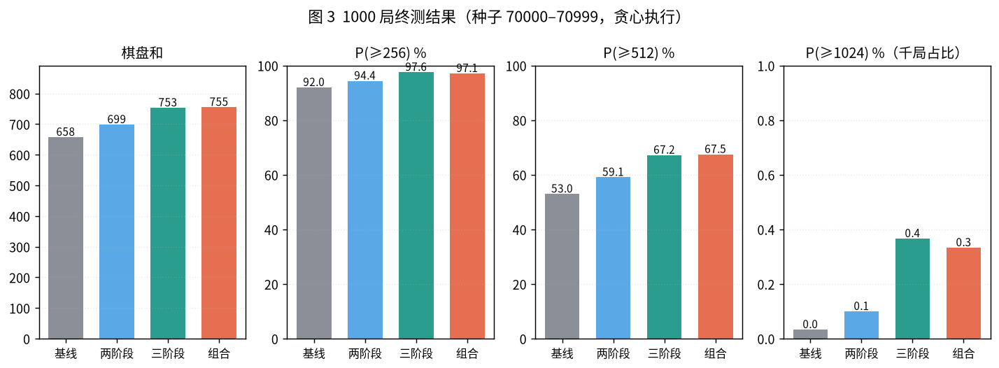

# 3×3 2048 · PPO 实验包

> ## ✅ 当前最优配置：**三阶段学习率调度 + 权重 EMA**
>
> | 指标 | 结果 |
> |---|---:|
> | 平均终局棋盘和 | **753.5** |
> | 期望得分 | **5,050** |
> | P(最大块 ≥ 256) | **97.6%** |
> | P(最大块 ≥ 512) | **67.2%** |
> | P(最大块 ≥ 1024) | **0.37%** |
> | 占理论最优（3×3 强解 ≈5,470）| **92.3%** |
>
> 详细设计与复现见 **[BEST_CONFIG.md](BEST_CONFIG.md)**（唯一权威说明）。

以 3 个训练种子、每模型 1,000 局独立终测（种子 70000–70999）为准。

---

## 一、怎么训练出这个结果

```bash
python train.py --run-name my_best \
  --iters 6000 --extend-iters 6000 --extend-lr 6e-5 \
  --extend2-iters 6000 --extend2-lr 2e-5 \
  --ema-decay 0.999 \
  --epochs 10 --lr 6.25e-4 --seed 2
```

学习率分三段（总 18,000 迭代 = 147,456,000 环境步 ≈ 66 万局）：

| 阶段 | 迭代 | 学习率 | 作用 |
|---|---|---|---|
| 一 | 1–6000 | 6.25e-4 → 6.25e-5（线性退火）| 主学习 |
| 二 | 6001–12000 | **6e-5 恒定** | 精修 |
| 三 | 12001–18000 | **2e-5 恒定** | 超精修（最大单项增益）|

配合 **EMA**：训练全程使用原始权重采样与更新，另维护一份权重的指数滑动平均
（β=0.999）；每次验证时原始权重与 EMA 各测一次，取优者保存为 best.pt。

评测：

```bash
python evaluate.py --ckpt results/ultrafine_s2/best.pt --episodes 1000 --seed 70000 --env fast
```

## 二、相对早期配置的提升

| 指标 | 早期标准配置（单段退火）| **本方案（三阶段+EMA）** | 变化 |
|---|---:|---:|---:|
| 棋盘和 | 657.7 | **753.5** | **+95.8** |
| 期望得分 | 4,323 | **5,050** | +727 |
| P(≥256) | 92.0% | **97.6%** | +5.6 pp |
| P(≥512) | 53.0% | **67.2%** | +14.2 pp |
| P(≥1024) | 0.03% | **0.37%** | 约 12 倍 |



## 三、文档索引

| 文档 | 状态 | 内容 |
|---|---|---|
| **[BEST_CONFIG.md](BEST_CONFIG.md)** | ✅ **当前（权威）** | 实验设立、三项优化设计、完整结果表、复现命令、设计边界 |
| **[data/README.md](data/README.md)** | ✅ 当前 | 期中展示数据包索引：每个 PPT 结论对应哪个数据文件 |
| [PPO_IMPLEMENTATION.md](PPO_IMPLEMENTATION.md) | ⚠️ **结果部分已过时** | 实现细节（状态编码 / 奖励 / 网络 / GAE / PPO-clip / 价值裁剪）仍准确；其中引用的成绩数字来自**早期单段退火配置**，请以 BEST_CONFIG.md 为准 |

## 四、代码索引

| 文件 | 内容 |
|---|---|
| game2048_env.py | 3×3 环境（Gymnasium 接口：状态编码、奖励、动作掩码、滑动合并）|
| game2048_env_fast.py | 向量化环境（64 环境并行，训练用）|
| ppo.py | PPO 核心：ActorCritic 双塔网络、GAE、PPO-clip 更新（含价值裁剪）|
| gpu_graph.py | CUDA Graph 加速：推理图 + 更新图，单步仅 1 次 H2D / 1 次 D2H |
| train.py | 训练脚本：多阶段学习率（--extend-*）、EMA（--ema-decay / --ema-decays）、--init-from |
| evaluate.py | 独立评估：贪心对局、统计、分布图、最优局棋谱 |
| eval_hidden.py | 宽度自适应的检查点评测（读取 ckpt 里的 hidden）|
| afterstate.py / branch_adv.py | afterstate 价值 / 分支采样（**已实测无收益**，仅作研究记录）|
| make_best_figs.py | 生成 figures/best/ 的 6 张报告图 |
| render_videos.py | 把真实对局逐步渲染为 MP4 |

## 五、数据与产物位置

| 路径 | 内容 |
|---|---|
| results/final_v2/ | 各配置 1,000 局终测（summary + 逐局 CSV + 训练曲线）+ [报告](results/final_v2/report.md) |
| results/ultrafine_s{2,3,4}/best.pt | **当前最优模型**（三阶段 + EMA，三个种子）|
| results/combo_s2/best.pt | 对局录像所用模型 |
| figures/best/ | 报告用图（学习率调度 / 训练曲线 / 终测对比 / 块分布 / 得分分布 / 对局里程碑）|
| videos/ | 真实对局录像（含 seed_70492 等）|
| data/ | 期中展示数据包（课件 + 检查点 + 逐局数据 + 录像）|

---

## 六、⚠️ 已过时的实验（保留作历史记录，请勿再引用其中的“最优”）

以下是本项目早期阶段的配置与结果，**均已被三阶段 + EMA 方案超越**，
对应数字只应作为“历史对照”，不要当作当前结论。

| 早期配置 | 棋盘和 | 状态 |
|---|---:|---|
| 默认（24.6M 步单段退火，seed 1）| 496.9 | ❌ 过时 |
| 10 epochs + lr 6.25e-4（5 种子）| 593.0 | ❌ 过时（曾被称为“最优”）|
| 预算 ×2（49.2M 步）| 657.7 | ❌ 过时（现今仅作基线）|
| 预算 ×4（98.3M 步，单段退火）| 619.1 | ❌ 过时（**反例**：单纯加预算会漂移）|
| 两阶段（退火 + 恒 6e-5）| 698.7 | ❌ 过时（三阶段的前身）|
| 固定 lr 2e-5 全程 | 342.3 | ❌ 过时（**反例**：起步用小 lr 学不动）|

已被实验否定的方向（结论：不要再用）：

| 方向 | 结果 |
|---|---|
| 网络加宽到 512 / 1024 | 持平或更差（容量不是瓶颈）|
| 折扣 γ 放宽到 0.998 | +3.9 分，不显著 |
| 奖励塑形（合成 512 加分 / 势函数）| −3.7 / −1.3 分，无效 |
| 分支采样（GRPO 式组内对比）| 592.6，显著劣于基线 |
| afterstate 价值 + 期望优势 | 熵塌缩，训练崩溃 |
| 热启动续跑（从 best.pt 继续）| best 检查点停在第 25–75 迭代，无收益 |
| 延长第三阶段 / 末段降到 1e-5 / 5e-6 | 均无显著收益（已饱和）|

对应的历史数据仍在 results/ 下（budget_extension / budget4x / ext2x_eval 等），仅供参考。

## 七、环境依赖

Python 3.10+、PyTorch（CUDA 可选）、numpy、matplotlib、gymnasium。
训练默认走 --env fast（向量化）并在 fast+cuda 时自动启用 CUDA Graph；如需关闭用 --no-graph。
